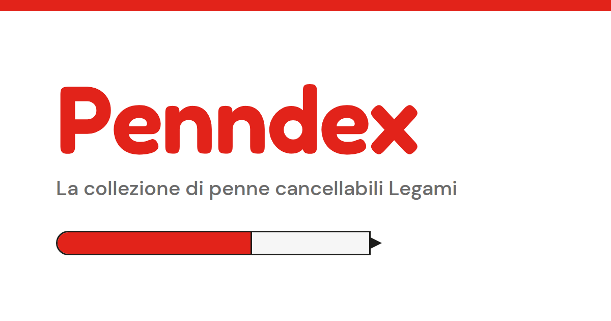

<div align="center">


# Penndex

**L’album digitale delle penne cancellabili Legami.**
Segna quelle che hai, scopri quelle che ti mancano e annota dove le hai trovate.

[**Apri Penndex →**](https://capriol.github.io/penndex/)

</div>



---

## Cos’è

Penndex è un raccoglitore in stile Pokédex per chi colleziona le penne cancellabili di Legami Milano. Le penne che hai sono a colori, quelle che ti mancano in bianco e nero, e una cartuccia d’inchiostro si riempie man mano che la collezione cresce.

È un progetto personale, nato per divertimento. Funziona nel browser, si installa come app sul telefono e tiene i tuoi dati solo sul tuo dispositivo.

## Cosa puoi fare

- **Sfogliare il catalogo:** 29 penne, ognuna con numero, nome, animale, frase e descrizione. Comprende le penne in vendita e alcune fuori produzione.
- **Segnare quelle che hai** con un tocco, dalla griglia o dalla scheda della penna.
- **Salvare un ricordo** per ogni penna: dove l’hai presa, quando, colore dell’inchiostro e note.
- **Rileggere il diario “Ricordi”**, con le penne raggruppate per mese e i posti dove le hai trovate.
- **Cercare, filtrare e ordinare:** per nome, animale, frase, negozio o note; tutte, solo le tue o solo quelle che mancano.
- **Aggiungere una foto** della tua penna al posto dell’illustrazione.
- **Aggiungere penne nuove** (uscite recenti, edizioni limitate) direttamente dal sito.
- **Andare a comprare quella che manca:** le penne in vendita hanno un link a legami.com nella loro scheda.
- **Usare il tema scuro.**
- **Fare un backup** della collezione in un file `.json` e ripristinarlo su un altro dispositivo.

## Installarla come app

Penndex è una Progressive Web App: si installa come un’app normale e funziona anche offline.

- **Android (Chrome):** apri il sito, menu ⋮ → **Installa app**.
- **iPhone (Safari):** apri il sito, pulsante Condividi → **Aggiungi alla schermata Home**.
- **Computer (Chrome, Edge):** icona di installazione nella barra degli indirizzi.

## I tuoi dati

La collezione è salvata solo nel browser del tuo dispositivo (`localStorage`). Non viene inviata a nessun server e non finisce in questo repository.

Conseguenze da sapere:

- ogni browser e ogni dispositivo ha la sua collezione;
- cancellare i dati di navigazione cancella anche la collezione;
- per spostarla o metterla al sicuro usa **Impostazioni → Scarica il backup**.

## Com’è fatto

Niente framework, niente librerie, niente build: HTML, CSS e JavaScript in un unico file, pubblicato con GitHub Pages.

| File | A cosa serve |
|---|---|
| `index.html` | Tutto il sito: struttura, stili, logica e catalogo delle penne. |
| `manifest.webmanifest` | Nome, icone e modalità dell’app installata. |
| `sw.js` | Service worker: rende il sito installabile e disponibile offline. |
| `favicon.svg`, `favicon.ico`, `apple-touch-icon.png` | Icone del sito nel browser e nella schermata Home. |
| `icon-192.png`, `icon-512.png`, `icon-maskable-512.png` | Icone dell’app installata. |
| `og-image.png` | Anteprima quando il link viene condiviso. |
| `sitemap.xml` | Mappa del sito per i motori di ricerca. |

Caratteri: [Fredoka](https://fonts.google.com/specimen/Fredoka) e [DM Sans](https://fonts.google.com/specimen/DM+Sans), da Google Fonts.

### Provarlo in locale

Apri `index.html` nel browser: funziona così com’è. Per provare anche app installabile e offline serve un piccolo server locale, perché i service worker non funzionano aprendo il file direttamente:

```bash
python3 -m http.server 8000
# poi apri http://localhost:8000
```

## Note

Penndex è un progetto personale, senza scopo di lucro. **Non è in alcun modo affiliato, collegato o approvato da Legami Milano (LEGAMI S.p.A.).** Nomi, marchi e prodotti citati appartengono ai rispettivi proprietari. Le illustrazioni del sito sono disegni generici con emoji, non immagini ufficiali.

---

<div align="center">

Made with ♥ by [capriol.](https://www.linkedin.com/in/giacomo-caprioli?utm_source=capriol&utm_medium=github)

</div>
